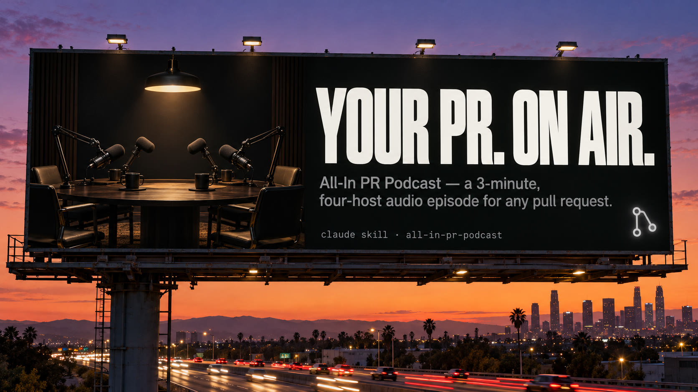

# all-in-pr-podcast



An agent skill that turns a GitHub pull request into a 2-3 minute,
four-host audio episode in the style of the All-In podcast:

- **Jason** moderates and keeps it moving.
- **Friedberg** explains exactly how the code works, starting with an
  everyday analogy.
- **Chamath** cuts in with the part that matters most.
- **Sacks** plays devil's advocate on the trade-offs.

After one listen you should know what the PR does, why it was made, how it
works, and what it traded away.

## Example episode

[Listen to `example-episode.mp3`](assets/example-episode.mp3) (3:17), made
from [mykclawd-tracker PR #3](https://github.com/mykcryptodev/mykclawd-tracker/pull/3),
which replaces a third-party PnL figure with cost basis computed from on-chain
swaps. GitHub doesn't play audio inline in a README; the link opens the file
page, where you can play or download it.

Fan parody, not affiliated with the All-In podcast. The skill uses stock
ElevenLabs library voices and refuses to clone or imitate the real hosts'
voices.

## Requirements

- An agent that supports skills (Claude Code, Pi, or anything that reads
  `SKILL.md`)
- [`gh`](https://cli.github.com/) authenticated to the PR's host
- `jq`, `ffmpeg`, and [`uv`](https://docs.astral.sh/uv/)
- An [ElevenLabs](https://elevenlabs.io) API key for realistic audio. Without
  one, the skill falls back to macOS `say`, which is robotic and macOS-only.

## Install

```bash
git clone https://github.com/mykcryptodev/all-in-pr-podcast ~/.claude/skills/all-in-pr-podcast
```

Set your ElevenLabs key one of two ways:

```bash
# Any OS: environment variable
export ELEVENLABS_API_KEY=...

# macOS: Keychain (prompts for the key without echoing it)
security add-generic-password -a "$USER" -s elevenlabs-api-key -w
```

## Use

Ask your agent:

> Make a podcast out of https://github.com/org/repo/pull/123

The skill fetches the PR, writes `notes.md` (including a claims ledger that
ties every technical claim to a file and line), writes `script.md`, checks
it, and renders `episode.mp3` to `~/pr-podcasts/<repo>-<number>/`.

You can also run the scripts directly:

```bash
OUT=$(scripts/fetch_pr.sh https://github.com/org/repo/pull/123)
# ...write $OUT/script.md...
uv run scripts/render.py "$OUT/script.md" --dry-run      # check length and cast balance
uv run scripts/render.py "$OUT/script.md" -o "$OUT/episode.mp3"
uv run scripts/render.py --list-voices                   # browse voices to recast
```

## Configure

- `voices.json`:
  - `elevenlabs`: voice IDs per host and the model (`eleven_v3`).
  - `say`: macOS fallback voices.
  - `pronunciations`: respellings sent to TTS only (Friedberg is said
    "Freedberg").
  - `speed`: optional per-host pace, pitch kept, for example
    `{"FRIEDBERG": 1.2}`. Empty by default (everyone at normal pace). With
    ElevenLabs, the renderer uses the timestamps endpoint to change only that
    host's segments of the dialogue.
  - `timing`: pauses between lines in seconds (0.35 between speakers, 0.15
    before an interruption). Applied between `say` lines and between
    ElevenLabs requests; lines never overlap.
- `references/personas.md`: each host's role and speech patterns.
- `references/example-episode.md`: a sample script showing the target shape.

## Cost

About 1 ElevenLabs credit per character, so a typical episode costs
2,000-3,000 credits.

## License

MIT
